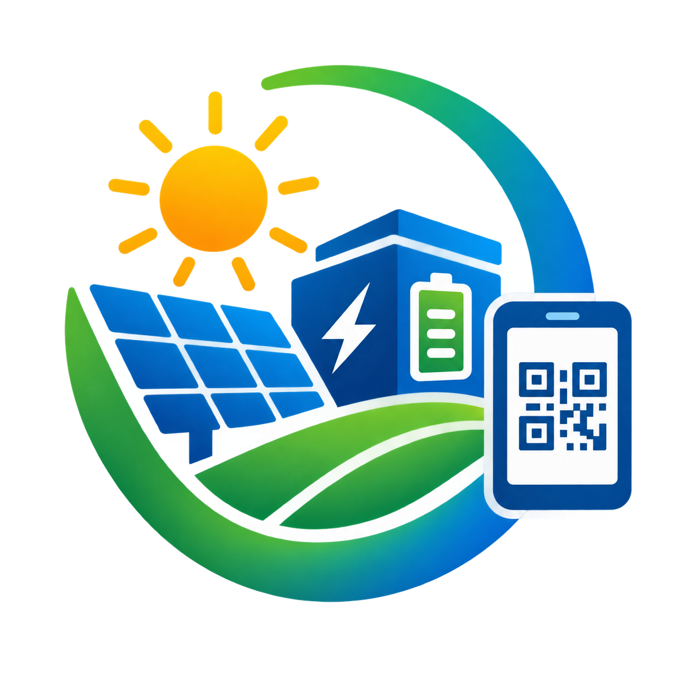

# SunGrid — Smart Solar Microgrid Trading System

SE4040 Enterprise Application Development · Year 4 Semester 2, 2026 · Group of 4

UI work in this repo follows a strict shared design system — see
[`docs/architecture/ui-design-system.md`](docs/architecture/ui-design-system.md) and `CLAUDE.md` §4a
before writing any web or Android UI code.

An end-to-end client–server system for reserving and verifying solar energy
transfers at microgrid hubs. A C# Web API holds all business logic; a React web
app serves back-office and grid-operator staff; a native Android app serves
prosumers and operators in the field.

---

## Repository layout

```
backend/          C# ASP.NET Web API — ALL business logic lives here
  src/SmartSolar.Api/
    Controllers/    thin: bind, authorise, call a service, map the result
    Services/       every business rule (BR-*) is enforced in here
    Repositories/   MongoDB access only — no rules
    Models/ DTOs/ Middleware/ Configuration/
  tests/            boundary tests for the 7-day and 12-hour rules

web/              React + Vite + TypeScript + Tailwind — UI layer only
  src/api/          the single place the web app calls the API
  src/features/     one folder per feature area, owned per CODEOWNERS
  src/pages/ components/ hooks/ lib/

mobile/           Pure native Android, Kotlin — UI layer + SQLite cache
  app/src/main/java/lk/sliit/smartsolar/
    data/local/     the four SQLite tables (ADR-004) — cache only
    data/remote/    Retrofit client
    ui/auth ui/prosumer ui/operator ui/map

docs/             The requirements knowledge base. Start at docs/README.md
scripts/          GitHub bootstrap, branch protection, git hooks
seed/             MongoDB sample data for the demo
.claude/skills/   open-pr and requirements-analyst skills for the team
.github/          CI workflows, CODEOWNERS, PR and issue templates
```

## Getting started

```bash
git clone https://github.com/<owner>/smart-solar-microgrid.git
cd smart-solar-microgrid
./scripts/install-hooks.sh        # blocks direct pushes and bad commit messages
git switch develop
```

### Backend

```bash
cp backend/src/SmartSolar.Api/appsettings.Development.json.example \
   backend/src/SmartSolar.Api/appsettings.Development.json
# fill in the Mongo connection string and the two signing secrets
dotnet restore backend/SmartSolar.sln
dotnet run   --project backend/src/SmartSolar.Api
dotnet test  backend/SmartSolar.sln
```

### Web

```bash
cd web
cp .env.example .env
npm install
npm run dev
```

### Mobile

Open `mobile/` in Android Studio, or:

```bash
cd mobile
gradle assembleDebug
```

The emulator reaches a locally hosted API at `http://10.0.2.2:<port>`, not
`localhost`.

## CI

| Check | Runs when | Required to merge |
|---|---|---|
| Backend Build | `backend/**` changes | ✅ |
| Web Build | `web/**` changes | ✅ |
| Mobile Build | `mobile/**` changes | ✅ |
| Guard — no secrets or build output | every PR | ✅ |
| Guard — PR title is a Conventional Commit | every PR | ✅ |

## AI use

This assignment is set at **AI Assessment Scale Level 2 — AI Planning**. AI was
used for planning, requirements structuring and research only. All
implementation is the team's own work. Each member's use is disclosed in their
individual contribution section of the report. See `CLAUDE.md` §7.
