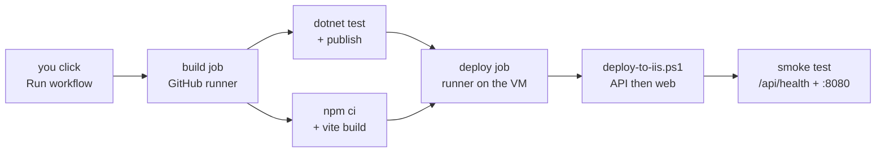

# Deployment Guide — Azure VM (Windows Server + IIS)

Status: **Agreed** · Owner: **all four members** (this earns group marks, not individual ones)
Target: **4 group marks** — "Hosting the Web API / Service on IIS (4)" + counts toward "MongoDB connection (4)"

This is the step-by-step version of `system-overview.md` §6. Do this once, early — **Day 13 in
`plan/work-breakdown.md` at the latest, ideally sooner** so both clients have a stable hosted URL to
build against instead of `localhost`.

---

## 0. What "deployed" actually means here, and what it doesn't

| Marked | Not marked, don't bother |
|---|---|
| API reachable over the network from both clients, on IIS | Auto-scaling, load balancing |
| MongoDB reachable from the hosted API | A managed CI/CD pipeline that redeploys on every push |
| A repeatable way to redeploy after a code change | A custom domain name |
| Secrets kept out of the repo | A production-grade cert from a paid CA |

This is a manual deploy you repeat by hand a handful of times over 15 days, not a pipeline. Don't over-build it.

## 1. One person owns the VM; everyone else gets the URL

Pick **one member** to hold the Azure account and the VM's admin password. Everyone else needs:
the VM's public IP (or DNS name), and to be added to `appsettings.Production.json`'s CORS origins if
you're testing from your own machine's web build. RDP access is optional — most of the team only
needs the base URL, recorded in `project-config.md` §9 once it exists.

## 2. Create the VM

**Fast path (Azure CLI)** — run this once, from any machine with the CLI installed and `az login` done:

```bash
az group create --name smartsolar-rg --location eastus

az vm create \
  --resource-group smartsolar-rg \
  --name smartsolar-api \
  --image Win2022Datacenter \
  --size Standard_B2s \
  --admin-username smartsolaradmin \
  --admin-password '<set a strong password — you will type this into RDP>' \
  --public-ip-sku Standard

az vm open-port --resource-group smartsolar-rg --name smartsolar-api --port 3389 --priority 900   # RDP
az vm open-port --resource-group smartsolar-rg --name smartsolar-api --port 80   --priority 910   # API (HTTP)
az vm open-port --resource-group smartsolar-rg --name smartsolar-api --port 443  --priority 920   # API (HTTPS, once set up)
```

`Standard_B2s` (2 vCPU, 4 GB) is enough for an API + a small IIS site and stays cheap on student
credit. Note the `publicIpAddress` the command prints — that's your base URL until you set up a name.

**Portal path**, if you'd rather click: Create a resource → Windows Server 2022 Datacenter → same size
→ under Networking, allow inbound RDP (3389), HTTP (80), HTTPS (443).

> **Restrict RDP to your own IP** if you can (`az vm open-port` with `--priority` lower than a
> `--source-address-prefixes` rule, or edit the NSG in the portal). Leaving RDP open to the whole
> internet is the most common way a student Azure VM gets compromised within days.

## 3. Cost control — stop it when you're not using it

Azure charges by the hour while the VM is running, even mid-build. Stop it (deallocate, not just
shut down inside Windows) whenever nobody needs it:

```bash
az vm deallocate --resource-group smartsolar-rg --name smartsolar-api   # stop billing
az vm start      --resource-group smartsolar-rg --name smartsolar-api   # resume — note: public IP may change unless you used --public-ip-sku Standard with a static allocation
```

If the IP changes on restart, every client's base URL breaks until updated — this is the one reason to
set a static public IP (the CLI command above already requests `Standard` SKU, which defaults to static).

## 4. RDP in and prepare the VM

Connect with Remote Desktop to the public IP, using the admin username/password from step 2. Then, in
an elevated PowerShell prompt on the VM:

```powershell
# Enable the IIS role and the management console
Install-WindowsFeature -Name Web-Server,Web-Mgmt-Console -IncludeManagementTools

# Download and install the ASP.NET Core Hosting Bundle (lets IIS run a .NET 8 app)
# Check https://dotnet.microsoft.com/download/dotnet/8.0 for the current exact link if this 404s.
Invoke-WebRequest -Uri "https://dotnet.microsoft.com/download/dotnet/8.0" -OutFile "$env:TEMP\hint.html"
# Get the "ASP.NET Core Runtime 8.0.x - Hosting Bundle" installer link from that page in a browser,
# then on the VM:
Invoke-WebRequest -Uri "<hosting-bundle-download-url>" -OutFile "$env:TEMP\dotnet-hosting-bundle.exe"
Start-Process "$env:TEMP\dotnet-hosting-bundle.exe" -ArgumentList "/quiet /norestart" -Wait

# The hosting bundle installs an IIS module (ASP.NET Core Module v2) - restart IIS so it's picked up
net stop was /y
net start w3svc
```

Confirm it worked: `Get-WebGlobalModule -Name AspNetCoreModuleV2` should return a result, not an error.

## 5. Create the IIS site and app pool

```powershell
Import-Module WebAdministration

New-Item "IIS:\AppPools\SmartSolarApi" -Force
Set-ItemProperty "IIS:\AppPools\SmartSolarApi" -Name managedRuntimeVersion -Value ""   # "No Managed Code" - required for .NET Core

New-Item "C:\inetpub\smartsolar-api" -ItemType Directory -Force

New-Website -Name "SmartSolarApi" -PhysicalPath "C:\inetpub\smartsolar-api" `
  -ApplicationPool "SmartSolarApi" -Port 80 -Force
```

## 6. Publish the API from your dev machine and copy it up

On your **own machine** (not the VM), from the repo root:

```bash
dotnet publish backend/src/SmartSolar.Api/SmartSolar.Api.csproj -c Release -o ./publish-output
```

Copy the contents of `publish-output/` to `C:\inetpub\smartsolar-api\` on the VM — over RDP clipboard
file copy, `scp` if you enable it, or zip it, upload via the Azure Portal's "Upload files" in Bastion/
Serial console, or a shared Azure Files share if you set one up. For a team of four redeploying
repeatedly, the least fiddly option is usually: zip → upload via RDP clipboard → unzip with
`Expand-Archive` on the VM.

**Before copying**, on the VM stop the app pool so files aren't locked:

```powershell
Stop-WebAppPool -Name "SmartSolarApi"
# ... copy/overwrite files in C:\inetpub\smartsolar-api ...
Start-WebAppPool -Name "SmartSolarApi"
```

`scripts/deploy-to-iis.ps1` in this repo automates the stop/copy/start loop — run it **on the VM**
after you've already copied a fresh `publish-output` folder there. See that script's header for usage.

## 7. Secrets — appsettings.Production.json lives only on the VM

**Never commit this file.** On the VM, create
`C:\inetpub\smartsolar-api\appsettings.Production.json` by hand (RDP in, use Notepad), based on
`backend/src/SmartSolar.Api/appsettings.Development.json.example`:

```json
{
  "Mongo": {
    "ConnectionString": "<your MongoDB Atlas connection string>",
    "DatabaseName": "smartsolar"
  },
  "Jwt": {
    "SigningKey": "<a long random value, different from any example you've seen>"
  },
  "Qr": {
    "SigningSecret": "<a different long random value>"
  }
}
```

Set the app pool's environment so ASP.NET Core actually loads this file:

```powershell
Set-ItemProperty "IIS:\AppPools\SmartSolarApi" -Name processModel.environmentVariables `
  -Value @{ ASPNETCORE_ENVIRONMENT = "Production" }
```

## 8. MongoDB — Atlas free tier, and let the VM in

1. [cloud.mongodb.com](https://cloud.mongodb.com) → create an M0 (free) cluster.
2. Database Access → create a user with a strong password, read/write on the `smartsolar` database.
3. Network Access → **Add IP Address** → enter the Azure VM's public IP (from step 2). Do **not** use
   "Allow access from anywhere" (`0.0.0.0/0`) for the actual demo build — that's an easy, avoidable
   security ding.
4. Copy the connection string (Atlas gives you a `mongodb+srv://...` URI) into
   `appsettings.Production.json` from step 7.
5. Run the seed script once against the hosted cluster:
   ```bash
   mongosh "<your connection string>/smartsolar" seed/seed.js
   ```

## 9. Smoke-test the API before touching the clients

From your own machine:

```bash
curl http://<vm-public-ip>/api/health
# expect: {"status":"ok","service":"SmartSolar.Api","utc":"..."}
```

If this fails, check (in order): Windows Firewall on the VM (port 80 inbound allowed — the Azure NSG
rule alone isn't enough, Windows has its own firewall too), the app pool is `Started` in IIS Manager,
`Get-EventLog -LogName Application -Newest 20` on the VM for a startup exception.

## 10. Point both clients at the hosted API

| Client | Change |
|---|---|
| Web app | `web/.env` → `VITE_API_BASE_URL=http://<vm-public-ip>/api`, then `npm run build` again |
| Android | `mobile/app/build.gradle.kts` → `buildConfigField("String", "API_BASE_URL", "\"http://<vm-public-ip>/api/\"")` |

Record the real base URL in `project-config.md` §9 (add it — see the stub below) so nobody hard-codes
a stale IP into a branch.

## 11. Host the React web app on the same IIS box

The marking scheme only requires the **API** on IIS (Table 1, "Hosting the Web API / Service on IIS
— 4 marks"). The web app is assessed as a UI layer, so it could live anywhere. Put it on the same VM
anyway: one machine to start before the demo, one IP to remember, and the report's "Hosting and
deployment steps" section covers both in one story.

Keep the API on port 80 and give the web app **port 8080**. Do not try to serve both from one site
under different paths — path-based routing means rewriting the API base URL and re-testing every
client, for no benefit.

### 11.1 Install the URL Rewrite module (one time, on the VM)

This is **not** part of the IIS role and is the single most common reason a deployed React app
half-works. Without it, `http://<ip>:8080/` loads but `http://<ip>:8080/backoffice/nodes` returns
404 — IIS looks for a folder called `backoffice` on disk and doesn't find one.

```powershell
Invoke-WebRequest -Uri "https://download.microsoft.com/download/1/2/8/128E2E22-C1B9-44A4-BE2A-5859ED1D4592/rewrite_amd64_en-US.msi" -OutFile "$env:TEMP\rewrite.msi"
Start-Process msiexec.exe -ArgumentList "/i $env:TEMP\rewrite.msi /quiet /norestart" -Wait
iisreset
```

If that URL 404s, search "IIS URL Rewrite module download" and take the current x64 installer.

### 11.2 Add a web.config to the repo

React Router owns the routing, so every URL that isn't a real file must be served `index.html` and
let the app sort it out. Create **`web/public/web.config`** — Vite copies everything in `public/`
into `dist/` verbatim, so this ships with every build and stays in version control:

```xml
<?xml version="1.0" encoding="utf-8"?>
<configuration>
  <system.webServer>
    <rewrite>
      <rules>
        <rule name="SPA fallback" stopProcessing="true">
          <match url=".*" />
          <conditions logicalGrouping="MatchAll">
            <add input="{REQUEST_FILENAME}" matchType="IsFile" negate="true" />
            <add input="{REQUEST_FILENAME}" matchType="IsDirectory" negate="true" />
          </conditions>
          <action type="Rewrite" url="/index.html" />
        </rule>
      </rules>
    </rewrite>
    <staticContent>
      <remove fileExtension=".woff2" />
      <mimeMap fileExtension=".woff2" mimeType="font/woff2" />
    </staticContent>
  </system.webServer>
</configuration>
```

Read the conditions as: *if the request is not an existing file and not an existing directory, serve
index.html instead.* Real assets still resolve normally.

### 11.3 Build with the production API URL baked in

**Vite substitutes `import.meta.env.VITE_*` at build time, not at runtime.** There is no config file
to edit on the server afterwards — if you build with `localhost`, the deployed site calls
`localhost` from the visitor's browser and every request fails. Rebuild whenever the API URL changes.

Create `web/.env.production` (gitignored, same as `.env`):

```
VITE_API_BASE_URL=http://<vm-public-ip>/api
```

Then, on your own machine:

```bash
cd web
npm ci
npm run build          # outputs to web/dist/, including web.config
```

Confirm the URL actually landed in the bundle before you upload anything:

```bash
grep -r "<vm-public-ip>" dist/assets/*.js | head -1
```

No output means the env file was not picked up — fix that now rather than debugging it on the VM.

### 11.4 Create the site and copy the build up

```powershell
New-Item "IIS:\AppPools\SmartSolarWeb" -Force
Set-ItemProperty "IIS:\AppPools\SmartSolarWeb" -Name managedRuntimeVersion -Value ""

New-Item "C:\inetpub\smartsolar-web" -ItemType Directory -Force

New-Website -Name "SmartSolarWeb" -PhysicalPath "C:\inetpub\smartsolar-web" `
  -ApplicationPool "SmartSolarWeb" -Port 8080 -Force
```

Copy the contents of `web/dist/` into `C:\inetpub\smartsolar-web\`, the same way you move the API
build up.

Then open port 8080 in **both** firewalls — the Azure NSG and Windows:

```powershell
New-NetFirewallRule -DisplayName "SmartSolarWeb 8080" -Direction Inbound -Protocol TCP -LocalPort 8080 -Action Allow
```

In the Azure portal: the VM's Network security group → Inbound port rules → add TCP 8080.

### 11.5 Check it

Browse to `http://<vm-public-ip>:8080` from your own machine. Then navigate to a deep route and
**hard-refresh** (Ctrl+Shift+R) — if that 404s, URL Rewrite or `web.config` is missing.

The browser is now calling `http://<ip>/api` from a page served at `http://<ip>:8080`. Different
port means different origin, so this is a cross-origin request. `Program.cs` currently registers
`AllowAnyOrigin()`, so it works as-is. If anyone tightens that CORS policy later, `http://<ip>:8080`
must be in the allowed list or the whole web app goes blank with CORS errors in the console.

## 12. HTTPS — do this if you have a spare hour, skip it if you don't

The assignment does not require HTTPS, and `usesCleartextTraffic="true"` is already set in the Android
manifest for exactly this reason. If you want it anyway (it's a legitimate line for the report's
"challenges" section either way — "we noted this and chose HTTP for the demo, here's why"):

```powershell
# On the VM - win-acme gets a free Let's Encrypt cert, but needs a real DNS name pointing at the VM,
# not just a bare IP. Set up an Azure DNS name label on the VM's public IP first (portal: the public
# IP resource -> Configuration -> DNS name label), then:
Invoke-WebRequest -Uri "https://github.com/win-acme/win-acme/releases/latest" -OutFile "$env:TEMP\wacs.zip"
Expand-Archive "$env:TEMP\wacs.zip" -DestinationPath "C:\win-acme"
C:\win-acme\wacs.exe   # interactive - point it at the SmartSolarApi site
```

If you skip this, use `http://` consistently everywhere (clients, CORS origins, the URL you demo from)
— a mix of `http://` and `https://` is a more common source of a broken demo than no HTTPS at all.

## 13. Redeploying after a code change — the loop you'll repeat

```bash
# on your machine
dotnet publish backend/src/SmartSolar.Api/SmartSolar.Api.csproj -c Release -o ./publish-output
# copy publish-output/* to the VM (RDP clipboard, zip+upload, whatever you settled on)
```
```powershell
# on the VM, after the fresh files are in place
./scripts/deploy-to-iis.ps1
```

Web app, whenever `web/` changes **or the API URL changes**:

```bash
cd web && npm run build      # re-bakes VITE_API_BASE_URL into the bundle
# copy web/dist/* to C:\inetpub\smartsolar-web on the VM
```

Do this after every merge to `develop` that touches `backend/`, not just once at the end — an API that
has drifted from what both clients were tested against for a week is how integration breaks on Day 28.

## 14. Troubleshooting

| Symptom | Likely cause |
|---|---|
| `502.5 Process Failure` in the browser | Hosting Bundle not installed, or `ASPNETCORE_ENVIRONMENT` not set to `Production` |
| Works via RDP-local `curl localhost`, not from your own machine | Windows Firewall on the VM, not just the Azure NSG |
| API starts but every request 500s | `appsettings.Production.json` missing, malformed, or the Mongo connection string wrong |
| Mongo connection times out | Atlas Network Access doesn't have the VM's current public IP (it changed after a deallocate/start without a static IP) |
| Android emulator can't reach it, physical device can | You're still using `10.0.2.2` — that only works for a locally-hosted API, not the VM |
| Web app home page loads, but refreshing any other route 404s | URL Rewrite module not installed, or `web.config` missing from `dist/` |
| Web app loads but every API call fails, console shows `localhost` | Built without `.env.production` — Vite bakes the URL in at build time, rebuild |
| Web app loads but console shows CORS errors | The API's allowed origins don't include `http://<ip>:8080` |
| `http://<ip>:8080` times out from your machine but works on the VM | Port 8080 open in only one of the two firewalls (Azure NSG *and* Windows) |

## 15. Automated deploys with GitHub Actions

Once the manual loop in §13 works, `.github/workflows/deploy.yml` automates it: one click builds,
tests, and deploys both sites, then smoke-tests them.

**It is manual on purpose.** The workflow has only a `workflow_dispatch` trigger — it never fires on
a push. §3 tells you to deallocate the VM between work sessions to save credit, and a deploy queued
against a stopped VM sits there until it times out. Deploying on your say-so, after you have started
the VM, avoids a whole class of confusing red builds. Run it from
**Actions → Deploy to Azure IIS → Run workflow**, choosing the branch in the dropdown (normally
`develop`).

### Why a self-hosted runner

The VM has no inbound deployment port — no Web Deploy on 8172, no SSH. Rather than open one and store
VM credentials in GitHub, install a **GitHub Actions runner on the VM**. It polls GitHub outbound and
pulls jobs, so nothing new is exposed and no password leaves the machine.

> **Only safe because this repo is private.** A self-hosted runner on a public repo will execute code
> from anyone's fork pull request, on your VM. If the repo is ever made public, delete the runner first.

### One-time install (on the VM, elevated PowerShell)

In GitHub: **Settings → Actions → Runners → New self-hosted runner → Windows**. It shows a download
block and a `config.cmd` line with a registration token. Run those, then when prompted:

- **labels** — add `smartsolar` (the workflow targets `[self-hosted, windows, smartsolar]`)
- **work folder** — accept the default

Then install it as a service so it survives reboots and runs without anyone logged in:

```powershell
cd C:\actions-runner
./svc.sh install    # on Windows this is: .\svc install
.\svc start
```

The service account needs to stop and start app pools, so run it as an account in the local
**Administrators** group. That is a real trade-off — a compromised runner is a compromised VM — and it
is acceptable here because the repo is private and the VM is disposable. Worth one line in the
report's challenges section.

### One-time repo settings

**Settings → Secrets and variables → Actions → Variables**, add:

| Variable | Value |
|---|---|
| `VITE_API_BASE_URL` | `http://<vm-public-ip>/api` |

A public IP is not a secret, so a variable (visible in logs) is correct here. The workflow fails
early with a clear message if it is missing, and fails again if the value doesn't appear in the built
bundle — the Vite build-time trap from §11.3, caught in CI instead of in the browser.

Nothing else is stored in GitHub. `appsettings.Production.json` stays on the VM, and
`deploy-to-iis.ps1` preserves it across every redeploy.

### What the workflow does



Building on GitHub's runners rather than the VM keeps the B2s free for serving the demo, and a failing
test means nothing is deployed at all.

### The catch: start the VM first

The `deploy` job runs on the runner installed *on the VM*, so the VM has to be started and the runner
service running before you trigger the workflow. Check **Settings → Actions → Runners** shows it as
**Idle** (green), not **Offline**, before clicking Run workflow. If you trigger it against a stopped
VM, the build job succeeds and the deploy job queues indefinitely — cancel it, start the VM, and run
it again.

The habit that works: merge PRs into `develop` freely all week, then start the VM and run the
workflow once before a demo or an integration test.

### Before you trust it

Run it once manually against a VM you have already deployed to by hand, and confirm
`appsettings.Production.json` is still on disk afterwards. `robocopy /MIR` deletes anything in the
destination that isn't in the source, and the secrets-preservation logic in `deploy-to-iis.ps1` is the
only thing standing between an automated deploy and a wiped config.

---

## Definition of done for this document

- [ ] VM created, public IP recorded in `project-config.md`
- [ ] IIS + Hosting Bundle installed, site + app pool created
- [ ] `appsettings.Production.json` present on the VM only, never committed
- [ ] MongoDB Atlas cluster created, VM's IP allow-listed, seed data loaded
- [ ] `GET /api/health` reachable from a machine that is not the VM itself
- [ ] Web app and Android both rebuilt against the hosted base URL
- [ ] URL Rewrite installed; a deep route survives a hard refresh at `http://<ip>:8080`
- [ ] `web/public/web.config` committed, so every future build ships the SPA fallback
- [ ] At least one full redeploy has been done using `scripts/deploy-to-iis.ps1`, so the process is proven before you need it under time pressure
